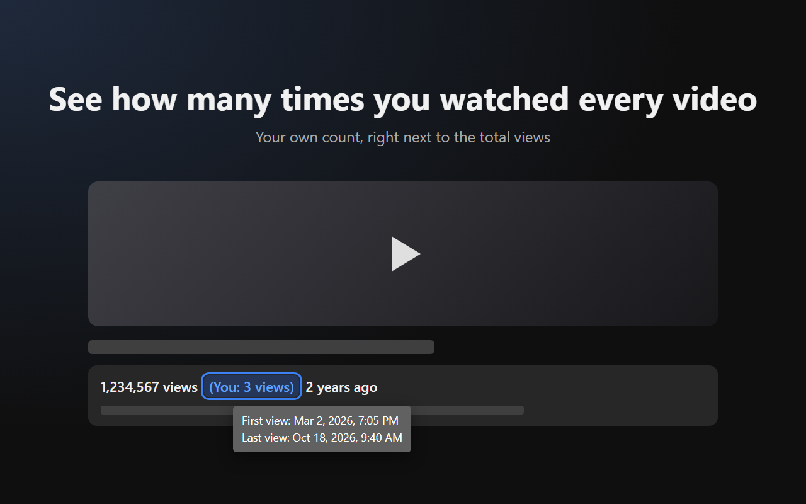
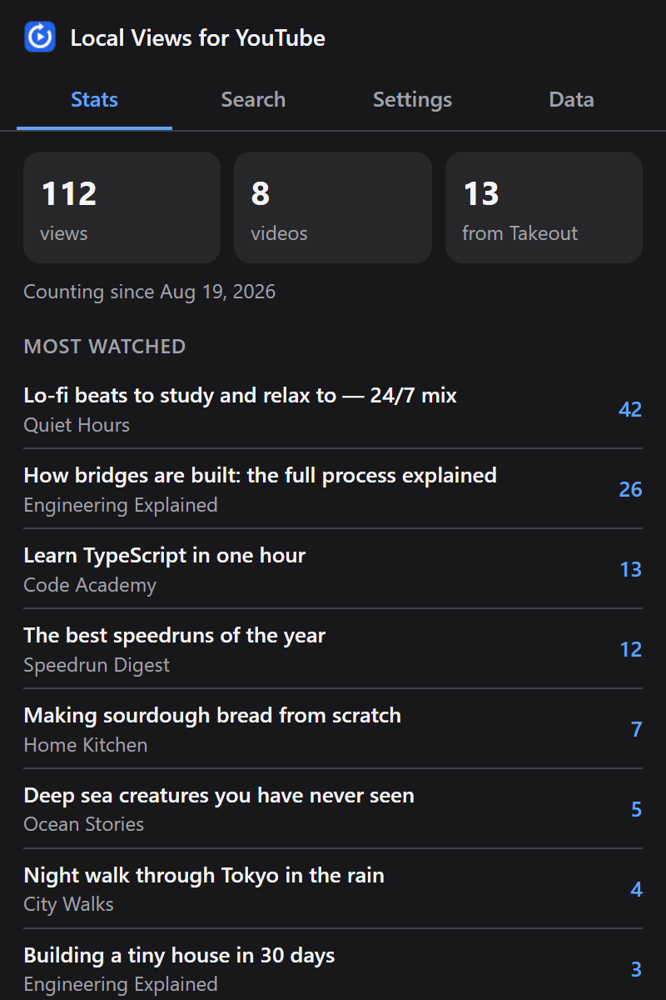
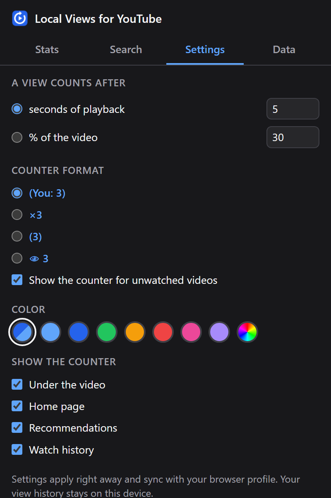
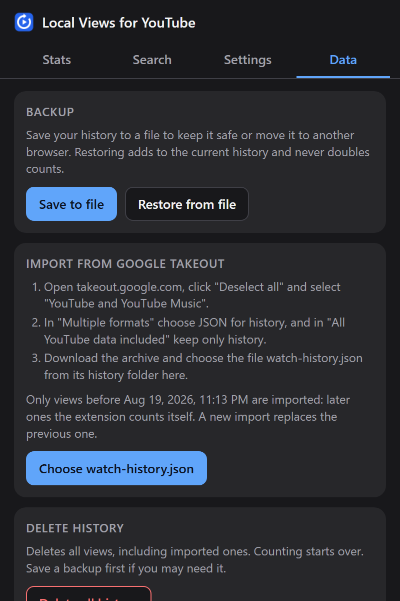
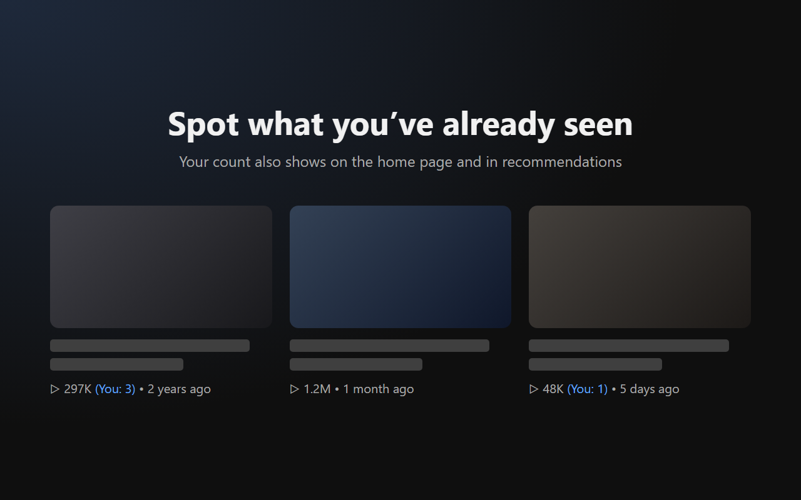

<p align="center">
  
</p>

<h1 align="center">Local Views for YouTube</h1>

<p align="center">
  See how many times <b>you</b> have watched every YouTube video — right next to its view count.<br>
  Your history never leaves your device.
</p>

<p align="center">
  <a href="https://github.com/LevHabarov/local-views-for-youtube/actions/workflows/ci.yml"></a>
  <a href="LICENSE"></a>
  
  
</p>

<p align="center">
  <b>English</b> · <a href="README.ru.md">Русский</a>
</p>

<p align="center">
  
</p>

## Features

- **Your count under every video.** `1,234,567 views (You: 3 views) 2 years ago` — hover it to see when you first and last watched the video.
- **On video cards too.** On the home page, in your watch history and in the recommendations next to a video, so videos you have already seen are easy to spot.
- **Honest counting.** A view is real playback, not just opening the page: seeking, pauses and ads don't count.
- **Stats and search.** Your most watched videos, recently watched, favorite channels, and a search through everything you've watched.
- **Import your past.** Bring years of history over from Google Takeout, so your counts are right from day one.
- **Make it yours.** Choose what counts as a view, the counter format and color, and where counters appear.
- **Private by design.** No accounts, no servers, no analytics. The extension makes no network requests at all.

## Screenshots

<table>
  <tr>
    <td align="center"><br><sub>Stats</sub></td>
    <td align="center"><br><sub>Settings</sub></td>
    <td align="center"><br><sub>Backup and Takeout import</sub></td>
  </tr>
</table>

<p align="center">
  
</p>

## Install

**Chrome Web Store:** coming soon.

**From a release:** download `local-views-for-youtube-<version>.zip` from [Releases](https://github.com/LevHabarov/local-views-for-youtube/releases), unzip it, then follow steps 2–4 below with the unzipped folder.

**From source** (Chrome and Yandex Browser; other Chromium-based browsers should work too):

1. Build the extension (Node.js 24 or newer):
   ```bash
   git clone https://github.com/LevHabarov/local-views-for-youtube.git
   cd local-views-for-youtube
   npm install
   npm run build
   ```
2. Open `chrome://extensions` and turn on **Developer mode**.
3. Click **Load unpacked** and choose the `dist/` folder.
4. Reload any open YouTube tabs.

## How views are counted

| Situation | Counts as a view? |
| --- | --- |
| The video played for 5 seconds (configurable) | ✅ |
| Watching again after the video ended | ✅ a new view |
| Every round in loop mode | ✅ a new view |
| Playing in a background tab or in the miniplayer | ✅ |
| Seeking, pauses and ads | ⏸ don't add time |
| Shorts, embedded players on other sites, YouTube Music | ❌ not yet |

Videos shorter than the threshold count once 90% of them has played. Instead of seconds, the threshold can be a share of the video's length, for example 30%.

## Import your history from Google Takeout

Without an import, counting starts when you install the extension. To bring your past views over:

1. Open [takeout.google.com](https://takeout.google.com), click **Deselect all** and select **YouTube and YouTube Music**.
2. In **Multiple formats**, choose **JSON** for history, and in **All YouTube data included** keep only history.
3. Download the archive, open the extension's popup → **Data** → **Choose watch-history.json**.

Only views from before the extension started counting are imported, so nothing is counted twice. Importing a newer Takeout file later replaces the previous import. Ads, YouTube Music and removed videos are skipped.

> [!TIP]
> Save a backup from the **Data** tab from time to time. Removing the extension deletes its data, and a backup restores everything — restoring never doubles your counts.

## Settings

| Setting | Options |
| --- | --- |
| A view counts after | N seconds of playback (default 5) or N% of the video |
| Counter format | `(You: 3)` · `×3` · `(3)` · `👁 3` |
| Unwatched videos | show `(You: 0)` or nothing |
| Color | automatic (follows YouTube's light or dark theme), presets, or your own |
| Where to show | under the video · home page · recommendations · watch history |

Settings apply right away and sync with your browser profile.

## Privacy

- Your watch history is stored only in the browser's local extension storage on your device.
- The extension makes **no network requests**, has no analytics and no tracking.
- Imported and exported files are read and saved locally.
- Only your settings sync through your browser profile; they contain no history.
- It runs only on `www.youtube.com` and asks for just two permissions: `storage` and `unlimitedStorage` (so a large imported history fits).

Full policy: [PRIVACY.md](PRIVACY.md).

## Development

```bash
npm install
npm run build         # build the extension into dist/
npm test              # unit tests (Vitest)
npm run typecheck     # TypeScript
npm run package       # build and pack dist/ into a zip for the Chrome Web Store
npm run icons         # redraw public/icons/*.png
npm run store-assets  # render the store screenshots and promo tiles (needs Google Chrome)
```

After rebuilding, click ⟳ on the extension's card in `chrome://extensions` and reload the YouTube tabs: tabs opened before the reload keep running the old script.

### How it works

```
YouTube page
 ├─ bridge.js   (page's main world)  reads the player: video ID, time, ads
 │      │ CustomEvent with JSON
 │      ▼
 ├─ content.js  (isolated world)     counts views, stores them, draws the counters
 │      │ chrome.storage.local
 │      ▼
 └─ popup.js    (extension popup)     stats, search, settings, import and export
```

The bridge runs in the page so it can call YouTube's player API; everything it sends is validated as untrusted input.

### Project layout

| Path | What's inside |
| --- | --- |
| `src/bridge/` | Main-world script that forwards the player's playback state |
| `src/content/` | Content script: counting (`index.ts`), the counter under the video (`badge.ts`), counters on cards (`cards.ts`) |
| `src/popup/` | The popup; its HTML and CSS are in `public/` |
| `src/core/` | Mostly pure logic: view rules, storage, Takeout import, backups, stats and search |
| `src/shared/` | The bridge message protocol and the settings |
| `public/` | Manifest, styles, locales (`_locales/en`, `_locales/ru`) and icons |
| `tests/` | Unit tests |
| `store/` | Chrome Web Store listing texts and images |

All YouTube DOM selectors live at the top of `badge.ts` and `cards.ts`, so when YouTube changes its markup there is one place to fix.

## Contributing

Bug reports and ideas are welcome in [issues](https://github.com/LevHabarov/local-views-for-youtube/issues). If a counter shows up in the wrong place, please attach a screenshot and the page URL — YouTube serves several page layouts.

## License

[MIT](LICENSE) © 2026 levanci

Local Views for YouTube is not affiliated with or endorsed by YouTube or Google.
