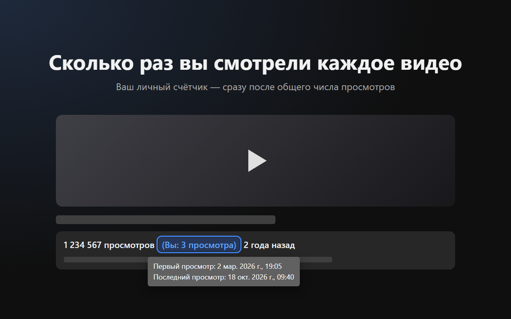
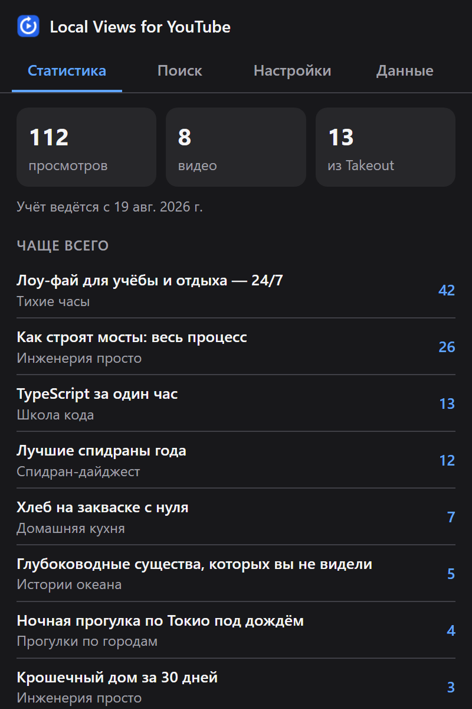
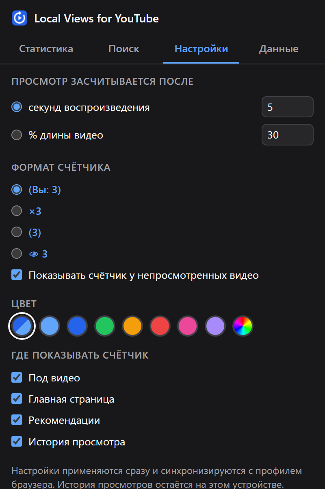
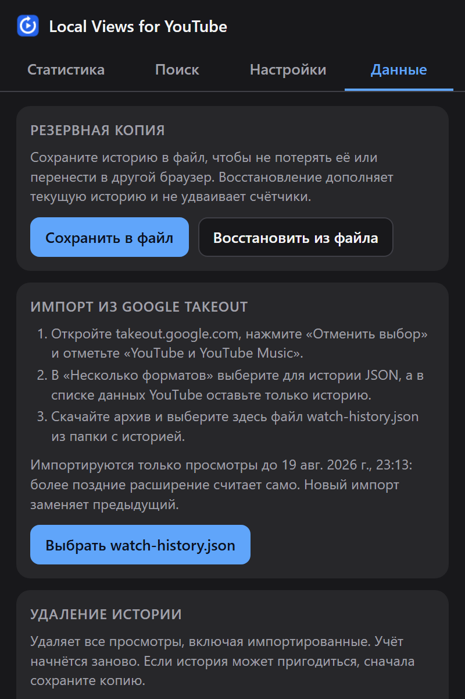
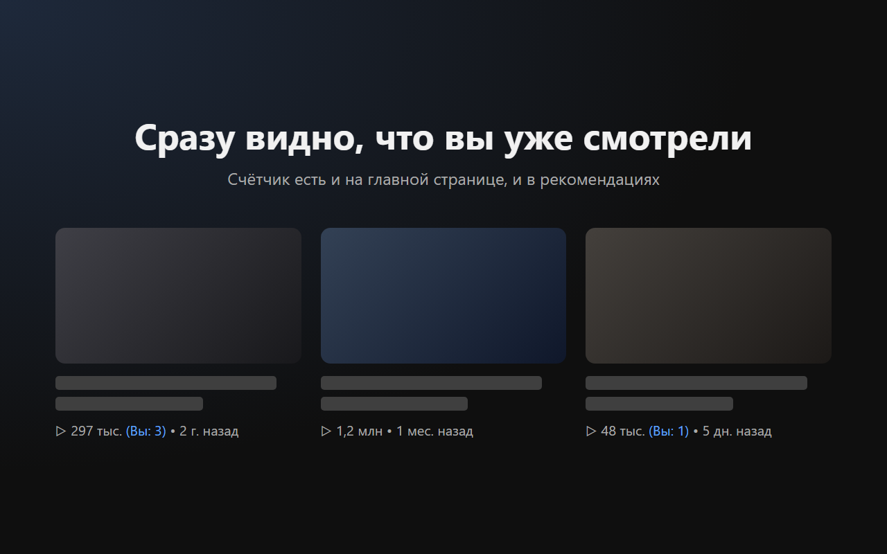

<p align="center">
  
</p>

<h1 align="center">Local Views for YouTube</h1>

<p align="center">
  Показывает, сколько раз <b>вы</b> смотрели каждое видео на YouTube, — прямо рядом с числом просмотров.<br>
  История не покидает ваше устройство.
</p>

<p align="center">
  <a href="https://github.com/LevHabarov/local-views-for-youtube/actions/workflows/ci.yml"></a>
  <a href="LICENSE"></a>
  
  
</p>

<p align="center">
  <a href="README.md">English</a> · <b>Русский</b>
</p>

<p align="center">
  
</p>

## Возможности

- **Ваш счётчик под каждым видео.** `1 234 567 просмотров (Вы: 3 просмотра) 2 года назад` — наведите на него, чтобы увидеть даты первого и последнего просмотра.
- **И на карточках.** На главной странице, в истории просмотра и в рекомендациях рядом с видео — уже просмотренное сразу видно.
- **Честный подсчёт.** Просмотр — это реальное воспроизведение, а не просто открытая страница: перемотка, пауза и реклама не считаются.
- **Статистика и поиск.** Самые пересматриваемые видео, недавние, любимые каналы и поиск по всей истории.
- **Импорт прошлого.** Перенесите годы истории из Google Takeout, чтобы счётчики были верными с первого дня.
- **Под себя.** Настройте, что считать просмотром, формат и цвет счётчика и где его показывать.
- **Приватность.** Без аккаунтов, серверов и аналитики. Расширение вообще не делает сетевых запросов.

## Скриншоты

<table>
  <tr>
    <td align="center"><br><sub>Статистика</sub></td>
    <td align="center"><br><sub>Настройки</sub></td>
    <td align="center"><br><sub>Резервная копия и импорт Takeout</sub></td>
  </tr>
</table>

<p align="center">
  
</p>

## Установка

**Chrome Web Store:** скоро.

**Из исходников** (Chrome и Яндекс Браузер; другие браузеры на Chromium тоже должны работать):

1. Соберите расширение (нужен Node.js 24 или новее):
   ```bash
   git clone https://github.com/LevHabarov/local-views-for-youtube.git
   cd local-views-for-youtube
   npm install
   npm run build
   ```
2. Откройте `chrome://extensions` (в Яндекс Браузере — `browser://extensions`) и включите **Режим разработчика**.
3. Нажмите **Загрузить распакованное расширение** и выберите папку `dist/`.
4. Обновите открытые вкладки YouTube.

## Что считается просмотром

| Ситуация | Просмотр? |
| --- | --- |
| Видео проигралось 5 секунд (можно настроить) | ✅ |
| Повтор после окончания видео | ✅ новый просмотр |
| Каждый круг в режиме повтора | ✅ новый просмотр |
| Воспроизведение в фоновой вкладке или мини-плеере | ✅ |
| Перемотка, пауза и реклама | ⏸ время не добавляют |
| Shorts, встроенные плееры на других сайтах, YouTube Music | ❌ пока нет |

Видео короче порога засчитывается, когда проиграно 90% его длины. Вместо секунд порог можно задать долей длины видео, например 30%.

## Импорт истории из Google Takeout

Без импорта учёт начинается с момента установки расширения. Чтобы перенести прошлые просмотры:

1. Откройте [takeout.google.com](https://takeout.google.com), нажмите **Отменить выбор** и отметьте **YouTube и YouTube Music**.
2. В **Несколько форматов** выберите для истории **JSON**, а в списке данных YouTube оставьте только историю.
3. Скачайте архив, откройте окно расширения → **Данные** → **Выбрать watch-history.json**.

Импортируются только просмотры до начала учёта расширением, поэтому ничего не считается дважды. Импорт более свежей выгрузки заменяет предыдущий. Реклама, YouTube Music и удалённые видео пропускаются.

> [!TIP]
> Время от времени сохраняйте резервную копию на вкладке **Данные**. При удалении расширения его данные стираются, а копия восстанавливает всё — и никогда не удваивает счётчики.

## Настройки

| Настройка | Варианты |
| --- | --- |
| Просмотр засчитывается после | N секунд воспроизведения (по умолчанию 5) или N% длины видео |
| Формат счётчика | `(Вы: 3)` · `×3` · `(3)` · `👁 3` |
| Непросмотренные видео | показывать `(Вы: 0)` или ничего |
| Цвет | автоматически (по светлой или тёмной теме YouTube), готовые цвета или свой |
| Где показывать | под видео · главная страница · рекомендации · история просмотра |

Настройки применяются сразу и синхронизируются с профилем браузера.

## Приватность

- История просмотров хранится только в локальном хранилище расширения на вашем устройстве.
- Расширение **не делает сетевых запросов**, в нём нет аналитики и слежки.
- Файлы для импорта и экспорта читаются и сохраняются локально.
- Через профиль браузера синхронизируются только настройки, истории в них нет.
- Расширение работает только на `www.youtube.com` и просит всего два разрешения: `storage` и `unlimitedStorage` (чтобы поместилась большая импортированная история).

Полный текст: [PRIVACY.md](PRIVACY.md).

## Разработка

```bash
npm install
npm run build         # собрать расширение в dist/
npm test              # юнит-тесты (Vitest)
npm run typecheck     # проверка типов TypeScript
npm run package       # собрать и упаковать dist/ в zip для Chrome Web Store
npm run icons         # перерисовать public/icons/*.png
npm run store-assets  # отрисовать скриншоты и промо-картинки для магазина (нужен Google Chrome)
```

После пересборки нажмите ⟳ на карточке расширения в `chrome://extensions` и обновите вкладки YouTube: в открытых до этого вкладках продолжает работать старый скрипт.

### Как это устроено

```
Страница YouTube
 ├─ bridge.js   (основной мир страницы)  читает плеер: ID видео, время, реклама
 │      │ CustomEvent с JSON
 │      ▼
 ├─ content.js  (изолированный мир)      считает просмотры, сохраняет, рисует счётчики
 │      │ chrome.storage.local
 │      ▼
 └─ popup.js    (окно расширения)        статистика, поиск, настройки, импорт и экспорт
```

Мост работает внутри страницы, чтобы обращаться к API плеера YouTube. Всё, что он передаёт, проверяется как недоверенные данные.

### Структура проекта

| Путь | Что внутри |
| --- | --- |
| `src/bridge/` | Скрипт в основном мире страницы, передаёт состояние плеера |
| `src/content/` | Контент-скрипт: подсчёт (`index.ts`), счётчик под видео (`badge.ts`), счётчики на карточках (`cards.ts`) |
| `src/popup/` | Окно расширения; его HTML и CSS лежат в `public/` |
| `src/core/` | В основном чистая логика: правила просмотра, хранилище, импорт Takeout, резервные копии, статистика и поиск |
| `src/shared/` | Протокол сообщений моста и настройки |
| `public/` | Манифест, стили, переводы (`_locales/en`, `_locales/ru`) и иконки |
| `tests/` | Юнит-тесты |
| `store/` | Тексты и картинки для Chrome Web Store |

Все селекторы DOM YouTube собраны в начале `badge.ts` и `cards.ts`: когда YouTube меняет вёрстку, чинить нужно в одном месте.

## Участие

Сообщения об ошибках и идеи — в [issues](https://github.com/LevHabarov/local-views-for-youtube/issues). Если счётчик встал не туда, приложите скриншот и адрес страницы: YouTube отдаёт несколько вариантов вёрстки.

## Лицензия

[MIT](LICENSE) © 2026 levanci

Local Views for YouTube не связано с YouTube и Google и не одобрено ими.
